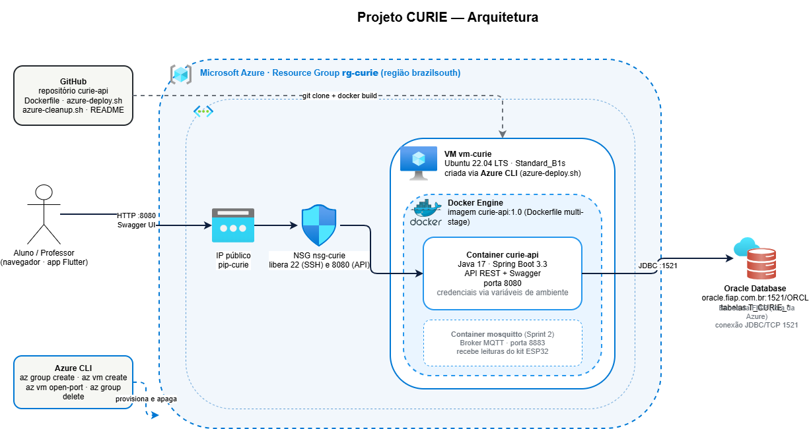

# CURIE DevOps — DevOps Tools & Cloud Computing · Sprint 1

Prova de conceito de **Docker + Cloud Computing (Microsoft Azure)** para o Projeto CURIE, usando a API Java desenvolvida em Java Advanced (reutilização permitida pelo enunciado).

- **Aplicação (código-fonte + Dockerfile):** https://github.com/kakarneiro/curie-api
- **Este repositório:** scripts Azure CLI, arquitetura, instruções e cópia do Dockerfile para consulta

## Grupo CURIE — Turma 2TDSPB

| Integrante | RM |
|---|---|
| Matheus Carneiro Maciel | 567753 |
| Murilo Marques | 568224 |
| Paulo Henrique da Silva Kian | 563343 |

**Vídeo (YouTube, não listado):** `COLOQUE-O-LINK-AQUI`

---

## 1. Arquitetura simplificada



Fonte editável: `docs/arquitetura-curie-devops.drawio` (diagrams.net, ícones oficiais Azure e Docker).

| Componente | Serviço | Função |
|---|---|---|
| Resource Group `rg-curie` | Azure | Agrupa todos os recursos; apagado ao final com um comando |
| VM `vm-curie` | Azure Virtual Machine (Ubuntu 22.04, Standard_B2s) | Hospeda o Docker Engine |
| IP público + NSG | Azure Networking | Expõe a porta 8080 (API) e 22 (SSH) |
| Container `curie-api` | Docker | API Spring Boot empacotada pelo `Dockerfile` |
| Oracle Database | FIAP (`oracle.fiap.com.br`) | Persistência (perfil padrão) |
| H2 em memória | dentro do container | Perfil `demo`, quando o Oracle não está acessível a partir da Azure |

Comunicação: **usuário → IP público (HTTP 8080) → NSG → container → Oracle (JDBC 1521)**. A VM é criada e destruída exclusivamente pelo **Azure CLI** (`azure-deploy.sh` / `azure-cleanup.sh`).

## 2. Docker

`Dockerfile` multi-stage (na raiz do repositório `curie-api`; cópia idêntica aqui em `Dockerfile`):

1. **build** — imagem `maven:3.9.9-eclipse-temurin-17` compila o projeto e gera `curie-api-1.0.0.jar`.
2. **runtime** — imagem `eclipse-temurin:17-jre`, usuário não-root, porta 8080, credenciais só por variáveis de ambiente.

```bash
# construir a imagem
docker build -t curie-api:1.0 .

# executar com o Oracle da FIAP
docker run -d --name curie-api -p 8080:8080 \
  -e ORACLE_USER=RM567753 -e ORACLE_PASSWORD='sua_senha' curie-api:1.0

# ou executar em modo demonstração (H2 em memória, sem Oracle)
docker run -d --name curie-api -p 8080:8080 -e SPRING_PROFILES_ACTIVE=demo curie-api:1.0

# comprovar
docker ps
curl http://localhost:8080/v3/api-docs
```

## 3. Azure CLI

`azure-deploy.sh` faz, nesta ordem:

```bash
az group create --name rg-curie --location brazilsouth
az vm create --resource-group rg-curie --name vm-curie --image Ubuntu2204 --size Standard_B2s \
             --admin-username curie --generate-ssh-keys --public-ip-sku Standard --nsg-rule SSH
az vm open-port --resource-group rg-curie --name vm-curie --port 8080 --priority 1010
az vm show --resource-group rg-curie --name vm-curie --show-details --query publicIps -o tsv
az vm run-command invoke ... "curl -fsSL https://get.docker.com | sh"          # instala Docker
az vm run-command invoke ... "git clone <repo> && docker build -t curie-api:1.0 ."
az vm run-command invoke ... "docker run -d -p 8080:8080 ... curie-api:1.0"
```

`azure-cleanup.sh` remove tudo:

```bash
az group delete --name rg-curie --yes
az group list --query "[?name=='rg-curie']" -o table   # deve voltar vazio
```

### Como executar

```bash
az login                                  # conta Azure for Students
git clone https://github.com/kakarneiro/curie-devops.git && cd curie-devops
chmod +x azure-deploy.sh azure-cleanup.sh

# opção A: Oracle da FIAP
ORACLE_USER=RM567753 ORACLE_PASSWORD='sua_senha' ./azure-deploy.sh

# opção B: demonstração sem Oracle
./azure-deploy.sh

# ao terminar o vídeo:
./azure-cleanup.sh
```

O script imprime o endereço final, por exemplo `http://20.206.xx.xx:8080/swagger-ui.html`. **Esse IP público é a prova de que a aplicação roda na VM, não em localhost.**

> No Windows, execute pelo **Git Bash** ou pelo **Azure Cloud Shell** (portal.azure.com → ícone `>_`), que já tem `az` e `bash`.

## 4. Como Docker e Cloud Computing podem ser utilizados na solução proposta pelo grupo?

O CURIE depende de um backend sempre disponível: o kit ESP32 de cada escola publica medições a qualquer hora, o app consulta o ranking e o mapa colaborativo agrega dados de várias cidades. **Docker** garante que a API Java rode exatamente igual no notebook do desenvolvedor, na VM da Azure e, no futuro, em um orquestrador — a imagem carrega Java, dependências e configuração, e as credenciais ficam fora dela, em variáveis de ambiente. Isso elimina o "na minha máquina funciona" e permite subir uma nova versão em segundos.

**Cloud Computing** resolve a escala e o custo: na Sprint 1 uma única VM Standard_B2s atende o protótipo; na Sprint 2 o mesmo container pode ir para Azure Container Apps com escala automática, o broker MQTT ganha seu próprio container e o banco migra para um serviço gerenciado. Como tudo é criado por script (Azure CLI), um aluno recria o ambiente inteiro em cinco minutos e apaga quando não precisa — sem custo parado, o que importa para um projeto de escolas públicas. Na prática, Docker e nuvem são o que transforma o kit de R$ 300 em uma plataforma nacional.

## 5. Estrutura dos arquivos

```
curie-devops/
├── README.md                       ← este documento
├── Dockerfile                      ← cópia do Dockerfile usado no curie-api
├── azure-deploy.sh                 ← cria RG, VM, NSG, Docker, build e run
├── azure-cleanup.sh                ← apaga o resource group
├── docs/
│   ├── arquitetura-curie-devops.drawio   ← fonte (diagrams.net)
│   ├── arquitetura-curie-devops.png
│   └── roteiro_video.md
└── entrega/
    └── CURIE_DevOps_Entrega.md     ← modelo do PDF final (nome, RM, links)
```

> O `azure-deploy.sh` clona o `curie-api` dentro da VM e executa o `docker build` lá; por isso o código-fonte não precisa estar neste repositório.
